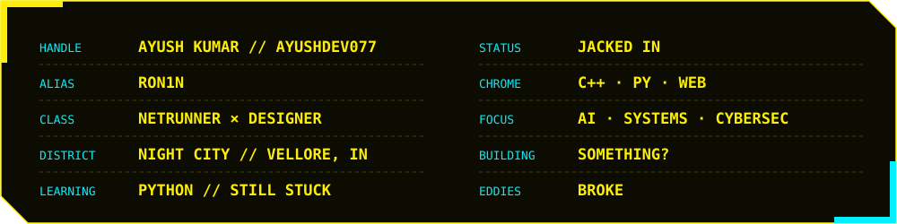
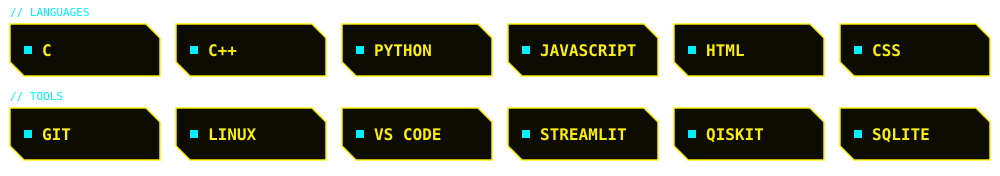

  

 

<blockquote>
I'm Ayush — an 18-year-old programmer and designer who turns 3 a.m. ideas into working software. Everything here is designed, built and shipped by me — no fixers, no corpos, no middlemen. Currently jacked into AI and systems engineering, one daemon at a time.
</blockquote>

  
  
  

  
  
   
  

  
    
  
  
  
  
  

